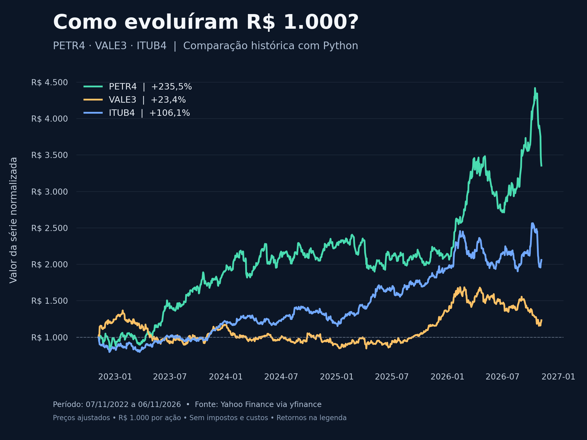

# Michael Alves Lima

### Análise de Dados | Python · SQL · Power BI · Excel

Sou estudante de Ciências de Dados na FAM e atuo com análise de dados e rotinas administrativas na Inbox Organização e Limpeza. Trabalho com organização de dados operacionais, relatórios, indicadores, análise de estoque, curva ABC e apoio à precificação.

Neste portfólio, compartilho projetos para aplicar meus estudos, apresentar minhas análises e acompanhar minha evolução na área de dados.

[LinkedIn](https://www.linkedin.com/in/michael-lima-59970821b/) · [Contato por e-mail](mailto:michaelimalves@gmail.com)

## Conhecimentos

- **Análise e visualização:** Power BI, Excel, relatórios e indicadores de negócio.
- **Dados:** SQL, organização, tratamento e análise exploratória de dados.
- **Programação:** Python em desenvolvimento, com aplicação prática de pandas, NumPy e Matplotlib.
- **Negócio:** curva ABC, estoque e precificação de produtos.

## Projetos

### Análise de ações brasileiras com Python

Comparação histórica de **PETR4, VALE3 e ITUB4** para explorar a relação entre retorno e risco em quatro anos de dados.

| Etapa | O que foi desenvolvido |
| --- | --- |
| Coleta | Consulta de preços ajustados com yfinance |
| Análise | Retorno acumulado e anualizado, volatilidade e drawdown máximo |
| Comparação | Correlação entre os retornos diários das ações |
| Visualização | Evolução normalizada de R$ 1.000 em cada ação |
| Documentação | Metodologia, fórmulas e instruções de execução |

**Ferramentas:** Python, pandas, NumPy, yfinance e Matplotlib.

O gráfico utiliza preços ajustados por dividendos e desdobramentos, sem impostos e custos de negociação. Período ilustrado: 07/11/2022 a 06/11/2026. Fonte: Yahoo Finance via yfinance.

**[Acessar o código e a documentação do projeto →](https://github.com/michaelimalves-stack/analise-acoes)**

## Formação

- **Bacharelado em Ciências de Dados** — FAM, em andamento.
- **Engenharia de Machine Learning e MLOps** — SENAI, em andamento.
- Formação complementar em análise de dados com Power BI e Excel.

## Contato

Estou em São Paulo e tenho interesse em oportunidades de desenvolvimento profissional em Análise de Dados, Business Intelligence e Ciência de Dados.

- [Perfil no LinkedIn](https://www.linkedin.com/in/michael-lima-59970821b/)
- [michaelimalves@gmail.com](mailto:michaelimalves@gmail.com)

---

Este portfólio será atualizado conforme novos projetos forem concluídos.
